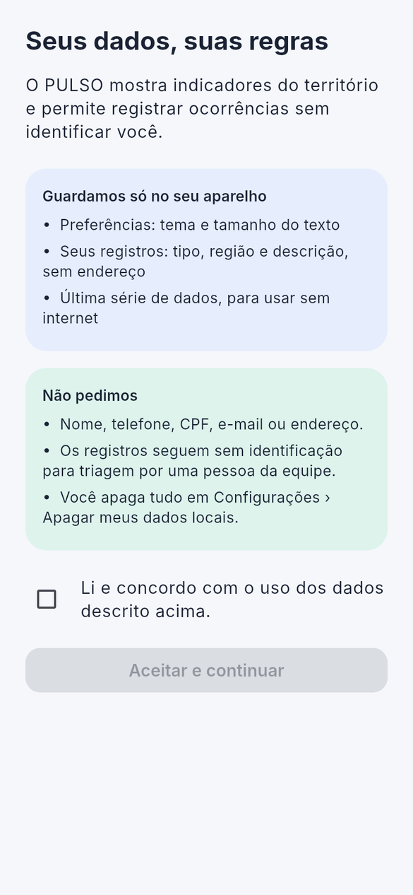
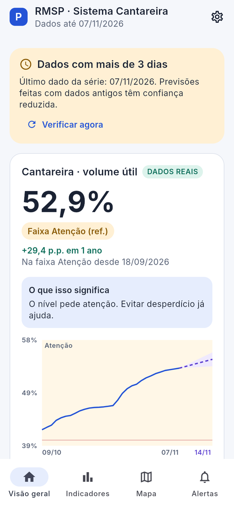
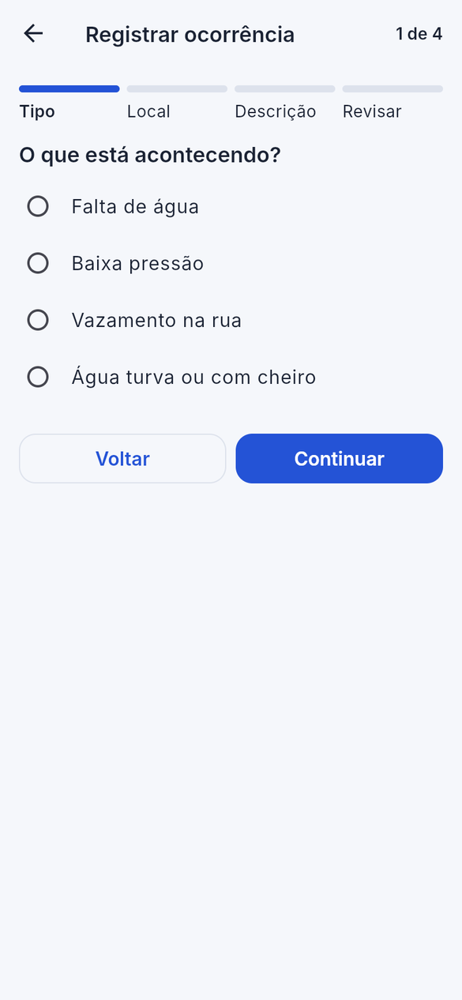
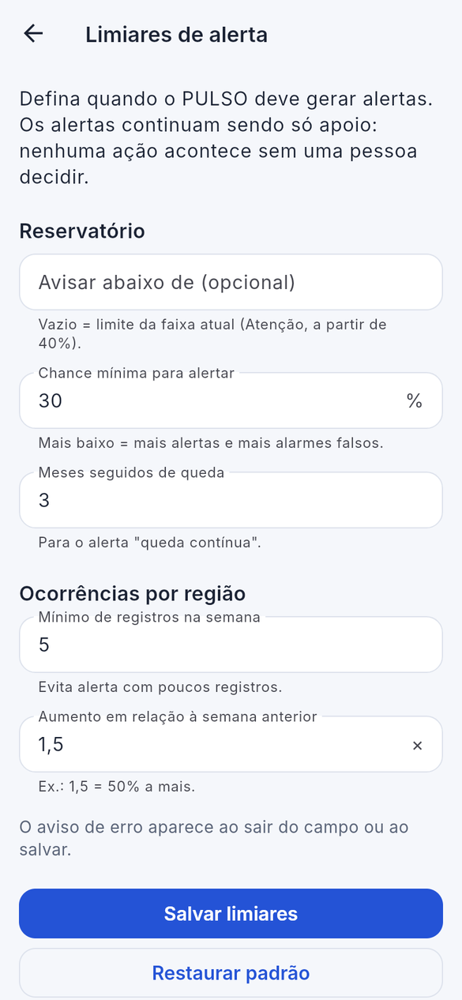

Integrantes: João Victor Alves de Abreu (RM 564946) e Rodrigo Kenshin Viana Matayoshi (RM 564026).

# PULSO — Radar Territorial

> App Flutter que antecipa a mudança de faixa do Sistema Cantareira e mostra, para cada alerta, a evidência, a confiança e os limites — a decisão final é sempre humana.

**Global Solution 2026.2 · Cross-Platform Application Development · FIAP** — tema *Territory Predictive Insights*.

## Problema e público

Metade da Região Metropolitana de São Paulo é abastecida pelo Sistema Cantareira, que opera em faixas definidas pela Resolução Conjunta ANA/DAEE nº 925/2017. Quando o volume cai de faixa, a retirada de água é reduzida — e moradores e gestores costumam saber disso tarde.

- **Gestores públicos**: acompanham indicadores, previsões e alertas, ajustam limiares e encaminham alertas para análise humana.
- **Cidadãos**: entendem a situação em linguagem simples e registram ocorrências sem se identificar.
- **Benefício social medido**: reexecutando a regra de alerta sobre a série real (2024–2026), o app teria avisado **6 de 6 pioras de faixa, com 5,8 dias de antecedência média** (ver [Benefício social](#benefício-social)).

## Integrantes

| Nome | RM |
|---|---|
| João Victor Alves de Abreu | 564946 |
| Rodrigo Kenshin Viana Matayoshi | 564026 |

## Demonstração visual

Capturas do app em 390×844 com os dados reais embutidos (série da Sabesp até 07/11/2026). Por isso aparece o aviso "Dados com mais de 3 dias": o app avisa e reduz a confiança das previsões quando o último dado envelhece.

| Consentimento | Visão geral | Alerta em destaque e benefício |
|---|---|---|
|  |  |  |

| Indicadores · Recursos | Fatores da previsão | Indicadores · Clima |
|---|---|---|
|  |  |  |

| Indicadores · Serviços | Mapa territorial | Alertas |
|---|---|---|
|  |  |  |

| Detalhe do alerta | Registro de ocorrência | Meus registros |
|---|---|---|
|  |  |  |

| Configurações | Limiares de alerta | Alto contraste + texto 200% | Tema escuro |
|---|---|---|---|
|  |  |  |  |

## Funcionalidades

- **Consentimento** explícito antes do uso, com o que é guardado e o que nunca é pedido.
- **Visão geral**: volume útil, faixa de operação, variação em 1 ano, "o que isso significa", gráfico de 30 dias + previsão com faixa de erro, aviso de mudança de faixa desde a última visita e "copiar resumo" com fonte.
- **Três dashboards** (`/indicadores/:aba`):
  - *Recursos* — série de 7/30/90 dias com faixas de referência, erro do modelo × baseline e "o que levou à previsão".
  - *Clima* — chuva na bacia × mesmo período do ano anterior e previsão de 5 dias da **Open-Meteo**.
  - *Serviços* — benefício social e registros por 100 mil habitantes.
- **Mapa territorial**: cartograma hexagonal com Hoje / +7 dias, painel da região, "Registrar aqui" e versão em lista.
- **Alertas** por regras transparentes, com risco, confiança, evidências, limitações e regra usada; detalhe em `/alertas/:id` e **encaminhamento para análise humana** (registrado, sem ação automática).
- **Registro de ocorrência** em 4 etapas com validação; dados pessoais detectados e removidos antes de salvar; protocolo aleatório.
- **Meus registros** com status real e fila offline (envio por API simulada).
- **Limiares de alerta** (formulário do gestor com validação) que recalculam os alertas em todas as telas.
- **Estados**: carregando, erro, vazio, cópia salva (offline) e dados desatualizados.
- **Acessibilidade**: temas claro, escuro e alto contraste; texto até 200%; reduzir animações; leitura simples; "ver como tabela" nos gráficos; `Semantics` nos números, gráficos e mapa.

## Dados

| Dado | Origem | Etiqueta no app |
|---|---|---|
| Volume útil, chuva, vazões do Cantareira (01/01/2024–07/11/2026) | Sabesp, Portal dos Mananciais — extraído e validado no projeto de Data Science da GS ([SHA-256 conferido](tool/build_pulso_data.py)) | DADOS REAIS |
| Previsão de 7 dias e métricas do modelo | Ridge (α = 100) do projeto DSA, reaplicado por `tool/build_pulso_data.py`; erro: validação walk-forward jan/2025–set/2026 | DADOS REAIS |
| Previsão do tempo (5 dias) | [Open-Meteo](https://open-meteo.com/) (API pública, sem chave), com cache local | — |
| Ocorrências por região | Sintéticas — não há dado público por região | DADOS SINTÉTICOS |

O pacote `assets/data/pulso_data.json` (esquema v1) é gerado por:

```bash
python3 tool/generate_placeholder_data.py   # regiões sintéticas
python3 tool/build_pulso_data.py            # série real + previsão Ridge
```

O app lê o pacote em três camadas: **fonte remota** (`--dart-define=PULSO_DATA_URL=…`) → **cache local** → **pacote embutido**. Cada tela sabe de onde veio o dado e quando.

## Alertas

1. **Previsão abaixo do limiar** — chance de o volume em 7 dias ficar abaixo do limite da faixa atual (ou do limiar do gestor) ≥ 30%. Chance = Φ((limiar − previsão) / erro típico).
2. **Queda contínua** — N janelas de 30 dias seguidas com média menor que a anterior.
3. **Alta de ocorrências** — ≥ 5 registros na semana e ≥ 1,5× a semana anterior; gravidade alta a partir de 8 (mesma regra do mapa).

- **Confiança**: < 60% baixa · 60–85% média · > 85% alta.
- **Quando não confiar**: dados com mais de 3 dias reduzem a confiança em um nível; com mais de 30 dias o alerta vira apenas informativo. A chance supõe erro aproximadamente normal; não considera chuvas extremas nem mudanças de operação; um único sistema produtor.
- **Decisão humana**: nenhuma regra executa ação. "Encaminhar para análise humana" só registra que uma pessoa assumiu a decisão.

## Benefício social

`LeadTimeBacktest` (`lib/features/alerts/domain/`) reexecuta a regra 1 em cada dia de 31/01/2024 a 07/11/2026 usando **apenas os dados até aquele dia** e mede quantos dias antes de cada piora de faixa o alerta começou:

| Pioras de faixa | Avisadas | Antecedência média | Dias com alerta | Sem piora em 7 dias |
|---|---|---|---|---|
| 6 | 6 | **5,8 dias** | 51 | 16 (acerto de 69%) |

Resultado conferido por uma reimplementação independente em Python sobre o mesmo JSON. A antecedência é limitada ao horizonte de 7 dias da previsão.

## Privacidade e inclusão

- Nada sai do aparelho sem consentimento; sem nome, telefone, CPF, e-mail ou endereço — só região.
- Descrições passam por um detector de dados pessoais, que avisa e mascara antes de salvar.
- "Apagar meus dados locais" remove registros, preferências, decisões, limiares e caches.
- Gravidade sempre com ícone + texto (nunca só cor); alvos de toque ≥ 48 dp; fonte Inter embutida (funciona offline).

## Tecnologias e decisões técnicas

| Escolha | Por quê |
|---|---|
| Flutter + Material 3 | Requisito da disciplina; `ThemeExtension` para cores semânticas nos 3 temas |
| flutter_riverpod | Estado global (dados, alertas, registros, limiares) separado do local (formulários, período); `AsyncValue` dá carregando/erro/dados |
| go_router (`StatefulShellRoute`) | Rotas nomeadas com parâmetros (`/indicadores/:aba`, `/alertas/:id`, `/ocorrencias/:protocol/enviada`) e 4 abas que preservam o estado |
| dio | Timeout e erros tipados nas fontes remotas |
| shared_preferences | Preferências, consentimento, limiares, decisões, registros e caches |
| Domínio em Dart puro | Faixas, previsão, confiança, motor de alertas, backtest e validações testados sem Flutter |

Estrutura: `lib/core` (tema, utilitários, resultado de dados), `lib/shared/widgets` (componentes), `lib/features/<feature>/{domain,data,presentation}`. Detalhes em [`docs/ARCHITECTURE.md`](docs/ARCHITECTURE.md).

## Testes

63 testes (`flutter test`), incluindo:

- motor de alertas, confiança, previsão, backtest (com resultado da série real), detector de dados pessoais, validações e repositórios;
- fluxo de consentimento, visão geral e aviso de mudança de faixa;
- **cada tela em 360 px com texto 200% e alto contraste** (qualquer estouro de layout reprova) e diretrizes de alvo de toque rotulado e ≥ 48 dp.

```bash
flutter analyze   # sem avisos
flutter test      # 63 testes
```

## Como executar

Requer Flutter 3.35+ (testado em 3.47.9).

```bash
git clone https://github.com/JoaoVictorAAbreu-Dev/gs-2026-cpad && cd gs-2026-cpad
flutter pub get
flutter run                 # Android, iOS, web ou Linux; usa o pacote embutido
flutter run --dart-define=PULSO_DATA_URL=https://<usuario>.github.io/pulso-data/pulso_data.json
```

Nenhuma chave de API é necessária. Para a demonstração offline: Configurações › "Simular sem internet".

## Vídeo

_Link pendente._ Roteiro em [`docs/VIDEO.md`](docs/VIDEO.md).

## Documentação do planejamento

Requisitos da rubrica, checklist de entrega e progresso em [`docs/`](docs/REQUIREMENTS.md).

## Licença

Projeto acadêmico — FIAP, Global Solution 2026.2. Fonte Inter sob SIL Open Font License 1.1 (`assets/fonts/inter/LICENSE-OFL.txt`). Dados do Cantareira: Sabesp, com atribuição.
