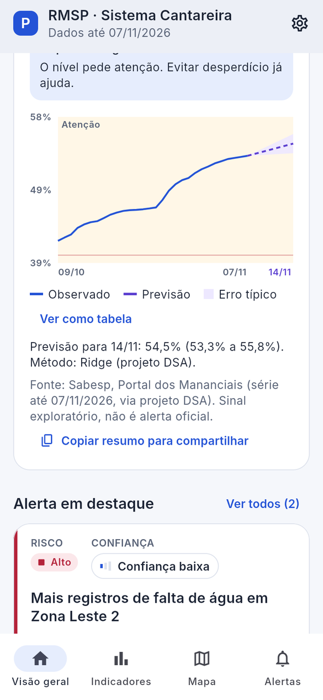
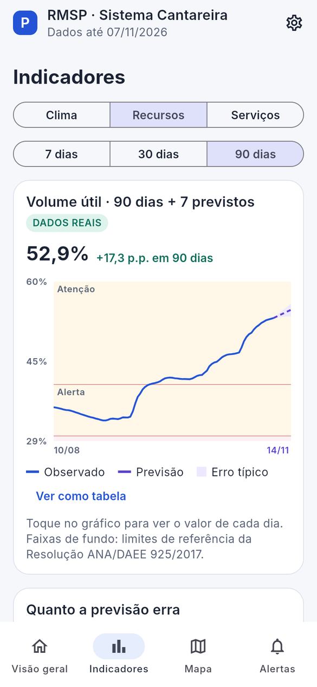
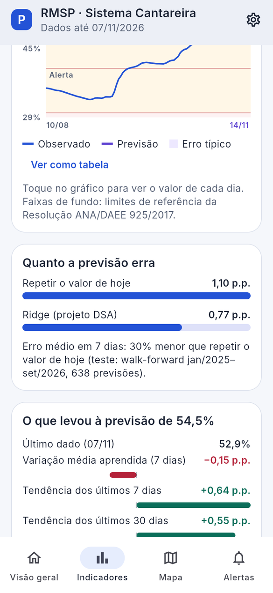
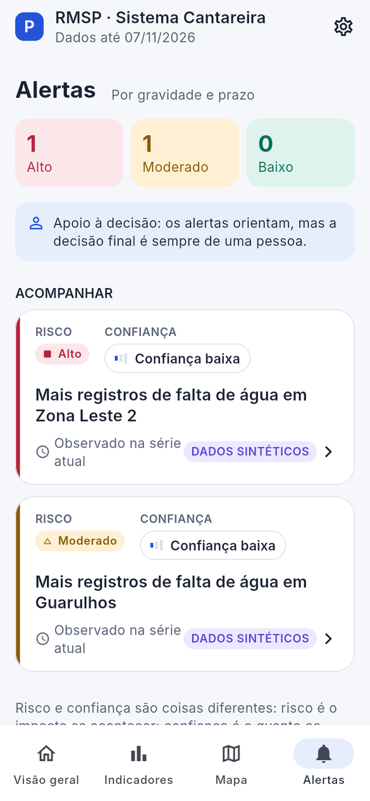
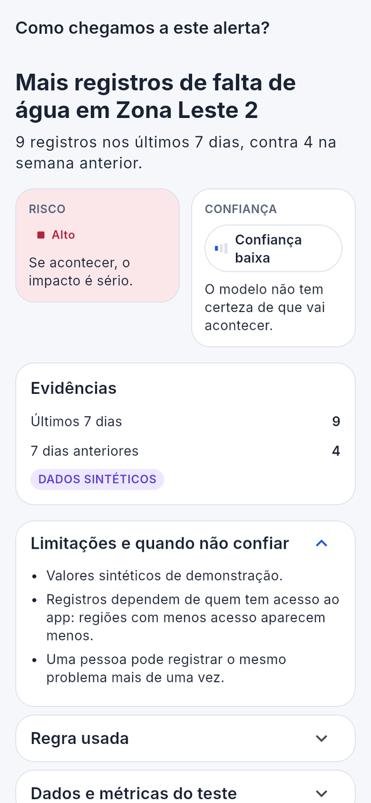
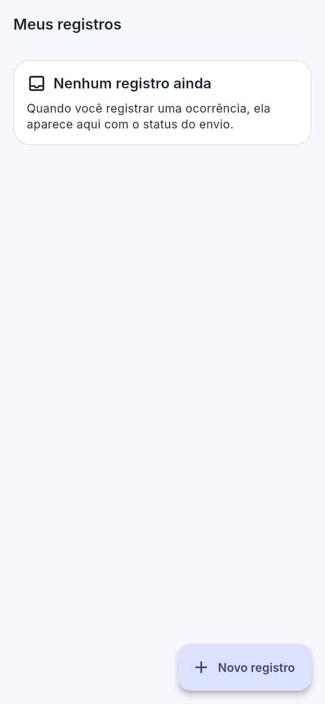
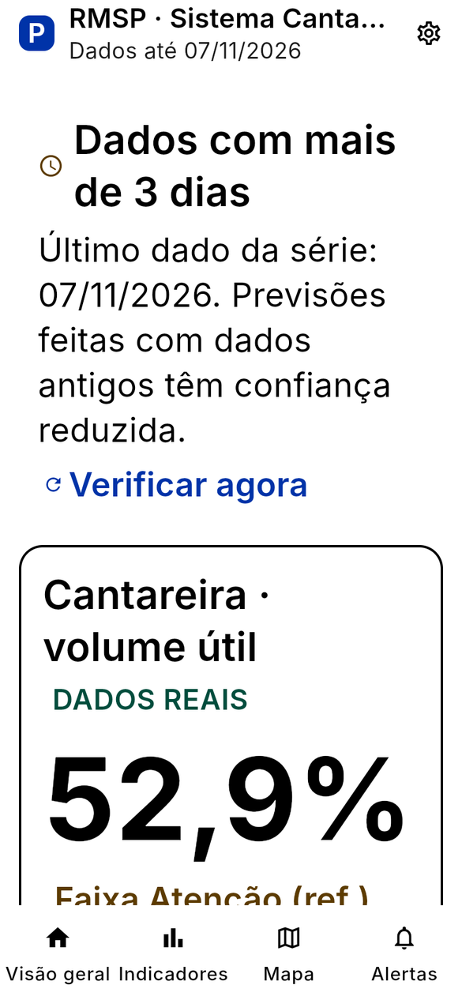
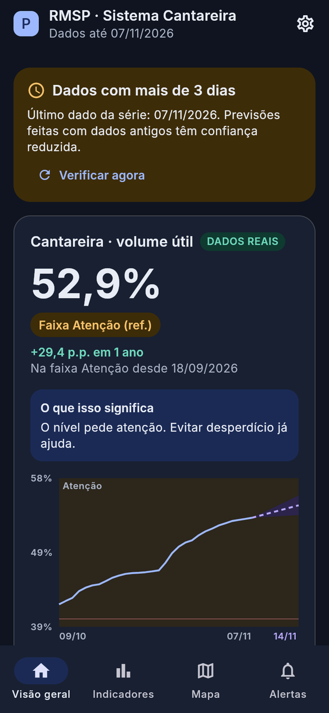

**Integrantes:** João Victor Alves de Abreu (RM 564946) e Rodrigo Kenshin Viana Matayoshi (RM 564026).

<div align="center">

# PULSO — Radar Territorial

**Aplicativo Flutter que antecipa a mudança de faixa do Sistema Cantareira e mostra, para cada alerta, a evidência, a confiança e os limites. A decisão final é sempre humana.**

Global Solution 2026.2 · Cross-Platform Application Development · FIAP · Tema *Territory Predictive Insights*

     

   

    

</div>

---

## Sumário

1. [Visão geral](#1-visão-geral)
2. [Demonstração visual](#2-demonstração-visual)
3. [Funcionalidades](#3-funcionalidades)
4. [Dados e fontes](#4-dados-e-fontes)
5. [Alertas e transparência](#5-alertas-e-transparência)
6. [Benefício social](#6-benefício-social)
7. [Privacidade e acessibilidade](#7-privacidade-e-acessibilidade)
8. [Arquitetura](#8-arquitetura)
9. [Testes e qualidade](#9-testes-e-qualidade)
10. [Como executar](#10-como-executar)
11. [Vídeo de demonstração](#11-vídeo-de-demonstração)
12. [Atendimento à rubrica](#12-atendimento-à-rubrica)
13. [Limitações conhecidas](#13-limitações-conhecidas)
14. [Créditos e licença](#14-créditos-e-licença)

---

## 1. Visão geral

### 1.1 Problema

Metade da Região Metropolitana de São Paulo é abastecida pelo **Sistema Cantareira**, que opera em cinco faixas definidas pela Resolução Conjunta ANA/DAEE nº 925/2017. Quando o volume muda para uma faixa pior, a retirada de água é reduzida — e moradores e gestores costumam saber disso tarde.

### 1.2 Público

| Público | Necessidade | O que o PULSO entrega |
|---|---|---|
| Gestor público | Saber antes, com clareza sobre o quanto confiar | Indicadores, previsão de 7 dias, alertas com evidência e confiança, limiares ajustáveis e encaminhamento para análise humana |
| Cidadão | Entender a situação e relatar problemas | Linguagem simples, mapa da região e registro de ocorrências sem identificação |

### 1.3 Solução em números

| Indicador | Valor | Observação |
|---|---|---|
| Volume útil do Cantareira | **52,9 %** | 07/11/2026, faixa Atenção, +29,4 p.p. em um ano |
| Previsão para 14/11/2026 | **54,5 %** | Ridge, erro típico de ±1,25 p.p. |
| Pioras de faixa avisadas | **6 de 6** | Backtest sobre 2024–2026 |
| Antecedência média | **5,8 dias** | Limitada ao horizonte de 7 dias |
| Testes automatizados | **68** | Inclui todas as telas com texto em 200 % |

## 2. Demonstração visual

Capturas em 390 × 844 com os dados reais embutidos (série até 07/11/2026). O aviso "Dados com mais de 3 dias" é intencional: quando o último dado envelhece, o app avisa e reduz a confiança das previsões.

<table>
  <tr>
    <td align="center"><br><sub>Consentimento</sub></td>
    <td align="center"><br><sub>Visão geral</sub></td>
    <td align="center"><br><sub>Alerta em destaque</sub></td>
    <td align="center"><br><sub>Indicadores · Recursos</sub></td>
  </tr>
  <tr>
    <td align="center"><br><sub>Fatores da previsão</sub></td>
    <td align="center"><br><sub>Indicadores · Clima</sub></td>
    <td align="center"><br><sub>Indicadores · Serviços</sub></td>
    <td align="center"><br><sub>Mapa OpenStreetMap</sub></td>
  </tr>
  <tr>
    <td align="center"><br><sub>Alertas</sub></td>
    <td align="center"><br><sub>Detalhe do alerta</sub></td>
    <td align="center"><br><sub>Registro de ocorrência</sub></td>
    <td align="center"><br><sub>Meus registros</sub></td>
  </tr>
  <tr>
    <td align="center"><br><sub>Configurações</sub></td>
    <td align="center"><br><sub>Limiares de alerta</sub></td>
    <td align="center"><br><sub>Alto contraste e texto 200 %</sub></td>
    <td align="center"><br><sub>Tema escuro</sub></td>
  </tr>
</table>

## 3. Funcionalidades

### 3.1 Telas e rotas

| Tela | Rota | Função |
|---|---|---|
| Consentimento | `/consentimento` | O que é guardado, o que nunca é pedido e aceite explícito |
| Visão geral | `/` | Volume, faixa, "o que isso significa", gráfico com previsão, alerta em destaque e benefício social |
| Indicadores | `/indicadores/:aba` | Três dashboards: `recursos`, `clima` e `servicos` |
| Mapa territorial | `/mapa` | Mapa OpenStreetMap com as represas e as regiões, cartograma offline e lista, com Hoje / +7 dias |
| Alertas | `/alertas` | Lista por gravidade e prazo |
| Detalhe do alerta | `/alertas/:id` | Evidências, risco × confiança, limitações, regra e encaminhamento |
| Registro de ocorrência | `/ocorrencias/nova?regiao=` | Quatro etapas com validação |
| Confirmação | `/ocorrencias/:protocol/enviada` | Protocolo e status real do envio |
| Meus registros | `/ocorrencias` | Histórico com fila offline |
| Configurações | `/configuracoes` | Tema, texto, notificações, acessibilidade e privacidade |
| Limiares de alerta | `/configuracoes/limiares` | Formulário do gestor |

### 3.2 Dashboards

| Dashboard | Gráficos e indicadores |
|---|---|
| **Recursos** | Volume em 7/30/90 dias sobre as faixas de referência, previsão com faixa de erro, erro do modelo × repetir o valor de hoje e contribuição de cada fator na previsão |
| **Clima** | Chuva acumulada na bacia × mesmo período do ano anterior e previsão de 5 dias da Open-Meteo |
| **Serviços** | Benefício social medido por backtest e registros por 100 mil habitantes por região |

### 3.3 Recursos transversais

- **Estados de interface**: carregando, erro, vazio, cópia salva (offline) e dados desatualizados.
- **Uso offline**: fonte remota → cache local → pacote embutido; registros ficam na fila até a conexão voltar.
- **Mudança de faixa**: aviso dentro do app desde a última visita e, se a pessoa ativar, **notificação do sistema** (uma por mudança).
- **Copiar resumo** com fonte para compartilhar.

## 4. Dados e fontes

| Dado | Origem | Etiqueta no app |
|---|---|---|
| Volume útil, chuva e vazões do Cantareira (01/01/2024–07/11/2026) | Sabesp, Portal dos Mananciais — extraído e validado no projeto de Data Science da GS, com SHA-256 conferido | `DADOS REAIS` |
| Previsão de 7 dias e métricas | Ridge (α = 100) do projeto de Data Science; erro da validação walk-forward jan/2025–set/2026 (638 previsões) | `DADOS REAIS` |
| Previsão do tempo (5 dias) | [Open-Meteo](https://open-meteo.com/), API pública sem chave, com cache local | — |
| Mapa base | [OpenStreetMap](https://www.openstreetmap.org/copyright) via flutter_map, com atribuição na tela | — |
| Posição das regiões e represas | Pontos centrais aproximados, só para orientação no mapa | — |
| Ocorrências por região | Sintéticas — não há dado público por região | `DADOS SINTÉTICOS` |

O pacote `assets/data/pulso_data.json` (esquema v1) é gerado pelos scripts em `tool/`:

```bash
python3 tool/generate_placeholder_data.py   # regiões sintéticas
python3 tool/build_pulso_data.py            # série real + previsão Ridge
```

## 5. Alertas e transparência

### 5.1 Regras

| Regra | Dispara quando | Gravidade |
|---|---|---|
| Previsão abaixo do limiar | Chance ≥ 30 % de o volume em 7 dias ficar abaixo do limite da faixa atual ou do limiar do gestor | Alta se levar às faixas Restrição ou Especial; moderada nas demais |
| Queda contínua | N janelas de 30 dias seguidas com média menor que a anterior | Moderada |
| Alta de ocorrências | ≥ 5 registros na semana e ≥ 1,5 × a semana anterior | Alta a partir de 8 registros (mesma regra do mapa) |

A chance é calculada como Φ((limiar − previsão) / erro típico), em que Φ é a distribuição normal acumulada.

### 5.2 Confiança e limites

| Situação | Efeito no alerta |
|---|---|
| Chance abaixo de 60 % · entre 60 % e 85 % · acima de 85 % | Confiança baixa · média · alta |
| Último dado com mais de 3 dias | Confiança reduzida em um nível |
| Último dado com mais de 30 dias | Alerta passa a ser apenas informativo |

Cada alerta lista suas limitações: erro supostamente normal, chuvas extremas, mudanças de operação e um único sistema produtor.

### 5.3 Decisão humana

Nenhuma regra executa ação. O botão **Encaminhar para análise humana** apenas registra, com data e hora, que uma pessoa assumiu a decisão.

## 6. Benefício social

A classe `LeadTimeBacktest` reexecuta a regra de previsão em cada dia de 31/01/2024 a 07/11/2026, usando **apenas os dados disponíveis até aquele dia**, e mede quantos dias antes de cada piora de faixa o alerta começou.

| Pioras de faixa | Avisadas | Antecedência média | Dias com alerta | Sem piora em 7 dias |
|:---:|:---:|:---:|:---:|:---:|
| 6 | **6** | **5,8 dias** | 51 | 16 (acerto de 69 %) |

O resultado foi conferido por uma reimplementação independente em Python sobre o mesmo arquivo de dados.

## 7. Privacidade e acessibilidade

| Privacidade | Acessibilidade |
|---|---|
| Consentimento antes de qualquer uso | Temas claro, escuro e alto contraste |
| Sem nome, telefone, CPF, e-mail ou endereço — apenas a região | Texto até 200 % sem quebrar a tela, testado em 360 px |
| Dados pessoais digitados são detectados e removidos antes de salvar | Gravidade sempre com ícone e texto, nunca só cor |
| Protocolo aleatório, sem identificador do aparelho | `Semantics` em números, gráficos e mapa; opção "ver como tabela" |
| "Apagar meus dados locais" remove tudo do aparelho | Alvos de toque ≥ 48 dp, reduzir animações e modo de leitura simples |

## 8. Arquitetura

### 8.1 Estrutura de pastas

```
lib/
├── app/            rotas (go_router), shell com 4 abas e providers globais
├── core/           tema (tokens, 3 modos), formatação pt-BR, detector de dados pessoais
├── shared/         componentes reutilizáveis (badges, gráfico, estados, cards)
└── features/
    ├── reservoir/  domínio (faixas, previsão) e repositório com fallback
    ├── alerts/     motor de alertas, confiança, backtest e telas
    ├── indicators/ três dashboards
    ├── map/        mapa OpenStreetMap, cartograma e risco por região
    ├── notifications/ notificação de mudança de faixa
    ├── reports/    registro de ocorrências e fila offline
    ├── weather/    Open-Meteo com cache
    ├── settings/   preferências, limiares e consentimento
    └── onboarding/ consentimento
tool/               geração do pacote de dados (Python)
test/               testes de unidade, de widget e de layout
```

### 8.2 Fluxo de dados

```
Sabesp (via projeto DSA) ─► tool/build_pulso_data.py ─► assets/data/pulso_data.json
                                                              │
fonte remota (opcional) ─► TerritoryRepository: remoto → cache → embutido
                                                              │
                                   territoryProvider (estado global)
                                          │                │
                                   alertsProvider    socialImpactProvider
                                          │
                     Visão geral · Alertas · Detalhe · Mapa
```

### 8.3 Decisões técnicas

| Escolha | Justificativa |
|---|---|
| Flutter + Material 3 | Requisito da disciplina; `ThemeExtension` para cores semânticas nos três temas |
| flutter_riverpod | Estado global (dados, alertas, registros, limiares) separado do local (formulários, período); `AsyncValue` representa carregando, erro e dados |
| go_router com `StatefulShellRoute` | Rotas nomeadas com parâmetros e quatro abas que preservam o estado |
| dio | Timeout e erros tipados nas fontes remotas |
| flutter_map + OpenStreetMap | Equivalente Flutter do Leaflet: mapa nativo, sem WebView, com marcadores acessíveis; o cartograma continua como alternativa offline |
| flutter_local_notifications | Notificação de mudança de faixa em Android, iOS, web e Linux, com pedido de permissão em tempo de execução |
| shared_preferences | Preferências, consentimento, limiares, decisões, registros e caches |
| Domínio em Dart puro | Faixas, previsão, confiança, alertas, backtest e validações testados sem Flutter |
| Fonte Inter embutida | Fiel ao design system e disponível offline |

Detalhes em [`docs/ARCHITECTURE.md`](docs/ARCHITECTURE.md). O design está no Figma *PULSO — Radar Territorial*, página "05 · Handoff Flutter".

## 9. Testes e qualidade

```bash
flutter analyze   # sem avisos
flutter test      # 68 testes
```

| Grupo | O que cobre |
|---|---|
| Domínio | Faixas, motor de alertas, confiança, previsão, backtest com o resultado da série real e validações |
| Dados | Repositório com fallback, cache corrompido e leitura da Open-Meteo |
| Privacidade | Detecção e mascaramento de dados pessoais |
| Notificação | Regra de uma notificação por mudança de faixa |
| Telas | Consentimento, visão geral, aviso de mudança de faixa e notificação do sistema (ligada e desligada) |
| Acessibilidade | Cada tela em 360 px com texto 200 % e alto contraste (qualquer estouro de layout reprova) e alvos de toque rotulados com ≥ 48 dp |

## 10. Como executar

### 10.1 Pré-requisitos

- Flutter 3.35 ou superior (testado em 3.47.9).
- Nenhuma chave de API.

### 10.2 Passos

```bash
git clone https://github.com/JoaoVictorAAbreu-Dev/gs-2026-cpad
cd gs-2026-cpad
flutter pub get
flutter run
```

O app roda em Android, iOS, web e Linux com os dados embutidos.

### 10.3 Opções

| Objetivo | Como |
|---|---|
| Buscar o pacote de dados de uma URL | `flutter run --dart-define=PULSO_DATA_URL=https://<usuario>.github.io/pulso-data/pulso_data.json` |
| Demonstrar o modo offline | Configurações › Simular sem internet |
| Ativar a notificação de mudança de faixa | Configurações › Avisar quando a faixa mudar (e "Enviar notificação de teste") |
| Recomeçar do consentimento | Configurações › Apagar meus dados locais |

## 11. Vídeo de demonstração

Link: _pendente_. O roteiro, com cenas, tempos e o critério da rubrica de cada cena, está em [`docs/VIDEO.md`](docs/VIDEO.md).

## 12. Atendimento à rubrica

| Requisito | Onde está |
|---|---|
| Ao menos cinco telas, rotas nomeadas e passagem de parâmetros | 11 telas (seção 3.1); parâmetros em `/indicadores/:aba`, `/alertas/:id`, `/ocorrencias/:protocol/enviada` e `?regiao=` |
| Três dashboards com gráficos, histórico e tendência | Recursos, Clima e Serviços (seção 3.2) |
| Alertas com evidência, confiança, limitações e decisão humana | Seção 5 |
| Estado local e global compartilhado entre telas | `alertsProvider` em 4 telas e `reportsProvider` em 3 telas |
| API real ou simulada, persistência local e uso offline | Open-Meteo, mapa OpenStreetMap, envio simulado, cache e fila offline |
| Formulário com validação | Registro de ocorrência e limiares de alerta |
| Tema, componentes reutilizáveis e responsividade | Tokens do Figma, `lib/shared/widgets`, testes em 360 e 390 px |
| Contraste, fonte ampliada e leitor de tela | Seção 7 |
| Anonimização, consentimento e indicador de benefício social | Seções 6 e 7 |

Requisitos, checklist de entrega e progresso em [`docs/`](docs/REQUIREMENTS.md).

## 13. Limitações conhecidas

- O último dado embutido é de 07/11/2026; para dados mais recentes, é preciso rodar `tool/build_pulso_data.py` com uma nova extração.
- Ocorrências por região são sintéticas e aparecem sempre com a etiqueta correspondente.
- O envio de registros usa uma API simulada; não há servidor de triagem real.
- A antecedência medida é limitada ao horizonte de 7 dias do modelo.
- A notificação de mudança de faixa é verificada ao abrir o app e ao atualizar os dados; não há verificação em segundo plano nem servidor de push.
- O mapa OpenStreetMap precisa de internet para os tiles; sem conexão, o cartograma e a lista continuam funcionando.
- As posições das regiões no mapa são aproximadas e servem só para orientação.

## 14. Créditos e licença

| Item | Fonte |
|---|---|
| Dados do Cantareira | Sabesp, Portal dos Mananciais, com atribuição |
| Previsão do tempo | Open-Meteo |
| Mapa base | © OpenStreetMap contributors (ODbL), exibido com flutter_map |
| Faixas de operação | Resolução Conjunta ANA/DAEE nº 925/2017 |
| Fonte tipográfica | Inter, SIL Open Font License 1.1 (`assets/fonts/inter/LICENSE-OFL.txt`) |

Projeto acadêmico — FIAP, Global Solution 2026.2.
