<div align="center">


# PULSO — Radar Territorial

**Aplicativo Flutter que antecipa a mudança de faixa do Sistema Cantareira e mostra, em cada alerta, a evidência, a confiança, a janela da previsão e os limites. O alerta apoia a análise; a decisão final é sempre humana.**

Global Solution 2026.2 · Cross-Platform Application Development · FIAP · Desafio *Territory Predictive Insights*

     

   

-0B6E5A) -F57C00)   

</div>

---

## Sumário

1. [Cabeçalho](#pulso--radar-territorial)
2. [Problema e público](#2-problema-e-público)
3. [Integrantes](#3-integrantes)
4. [Demonstração visual](#4-demonstração-visual)
5. [Funcionalidades](#5-funcionalidades)
6. [Dados e alertas](#6-dados-e-alertas)
7. [Privacidade e inclusão](#7-privacidade-e-inclusão)
8. [Tecnologias e decisões técnicas](#8-tecnologias-e-decisões-técnicas)
9. [Como executar](#9-como-executar)
10. [Vídeo](#10-vídeo)
11. [Licença](#11-licença)

---

## 2. Problema e público

### 2.1 Problema que o app antecipa

Metade da Região Metropolitana de São Paulo é abastecida pelo **Sistema Cantareira**, que opera em cinco faixas definidas pela Resolução Conjunta ANA/DAEE nº 925/2017 (Normal, Atenção, Alerta, Restrição e Especial). Quando o volume cai para uma faixa pior, a retirada de água é reduzida — e moradores e gestores costumam saber disso tarde, depois que a pressão já caiu nas torneiras. O PULSO antecipa essa mudança em até 7 dias e cruza o reservatório com a chuva da bacia e os relatos de falta de água por região.

### 2.2 Para quem

| Público | Necessidade | O que o PULSO entrega |
|---|---|---|
| Gestor público (defesa civil, subprefeitura, saneamento) | Saber antes, com clareza sobre o quanto confiar | Três dashboards, previsão de 7 dias, alertas com evidência, confiança, janela e limites, limiares ajustáveis e encaminhamento para análise humana |
| Cidadão | Entender a situação e relatar problemas sem se expor | Linguagem simples, mapa da região e registro de ocorrências sem identificação |

### 2.3 Impacto social esperado

| Indicador | Valor | Como foi medido |
|---|---|---|
| Pioras de faixa avisadas com antecedência | **6 de 6** | Backtest da regra de alerta em 2024–2026, usando só dados disponíveis em cada dia |
| Antecedência média | **5,8 dias** | Mesmo backtest; limitada ao horizonte de 7 dias |
| Erro da previsão de 7 dias | **0,77 p.p.** contra 1,10 p.p. de repetir o valor de hoje | Validação walk-forward jan/2025–set/2026 (638 previsões) |

Com quase uma semana de aviso, gestores podem preparar comunicação, caminhões-pipa e manobras antes da restrição — e o cidadão entende o motivo em vez de só sentir a falta de água. O indicador de benefício social aparece no app (dashboard Risco territorial e Visão geral).

## 3. Integrantes

| Nome completo | RM |
|---|---|
| João Victor Alves de Abreu | 564946 |
| Rodrigo Kenshin Viana Matayoshi | 564026 |

## 4. Demonstração visual

Capturas do app compilado para web em 390 × 844, com os dados reais embutidos (série até 07/11/2026). O aviso "Dados com mais de 3 dias" é intencional: quando o último dado envelhece, o app avisa e reduz a confiança das previsões.

**Fluxo principal demonstrado:** Visão geral → Dashboard → Detalhe do indicador → Alerta → Justificativa (evidência, confiança, janela, limitações) → Encaminhar para análise humana; e Registrar ocorrência → Meus registros.

<table>
  <tr>
    <td align="center"><br><sub><b>1.</b> Consentimento explícito</sub></td>
    <td align="center"><br><sub><b>2.</b> Visão geral com dado real</sub></td>
    <td align="center"><br><sub><b>3.</b> Alerta em destaque e benefício social</sub></td>
    <td align="center">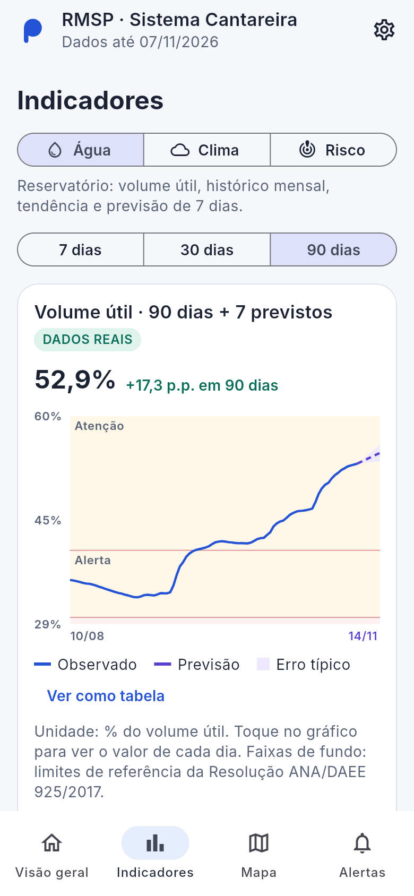<br><sub><b>4.</b> Dashboard Água: volume, tendência</sub></td>
  </tr>
  <tr>
    <td align="center">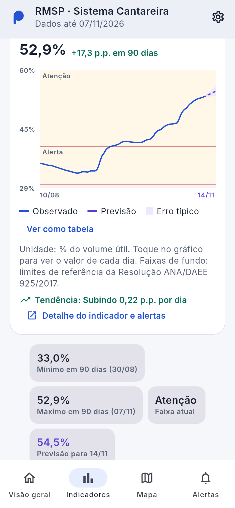<br><sub><b>5.</b> Água: mínimo, máximo e previsão</sub></td>
    <td align="center">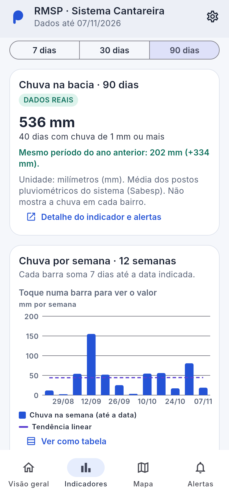<br><sub><b>6.</b> Dashboard Clima: chuva semanal</sub></td>
    <td align="center">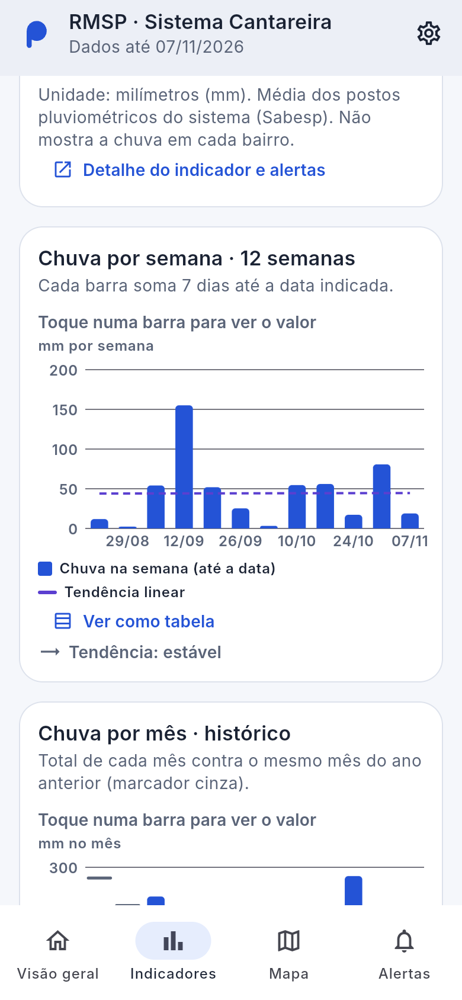<br><sub><b>7.</b> Clima: meses × ano anterior</sub></td>
    <td align="center">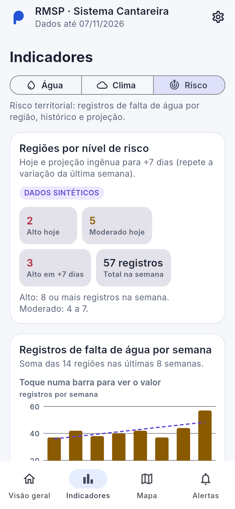<br><sub><b>8.</b> Dashboard Risco territorial</sub></td>
  </tr>
  <tr>
    <td align="center">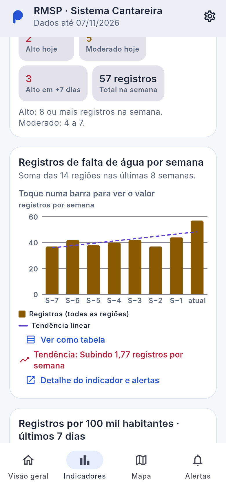<br><sub><b>9.</b> Risco: histórico semanal e ranking</sub></td>
    <td align="center">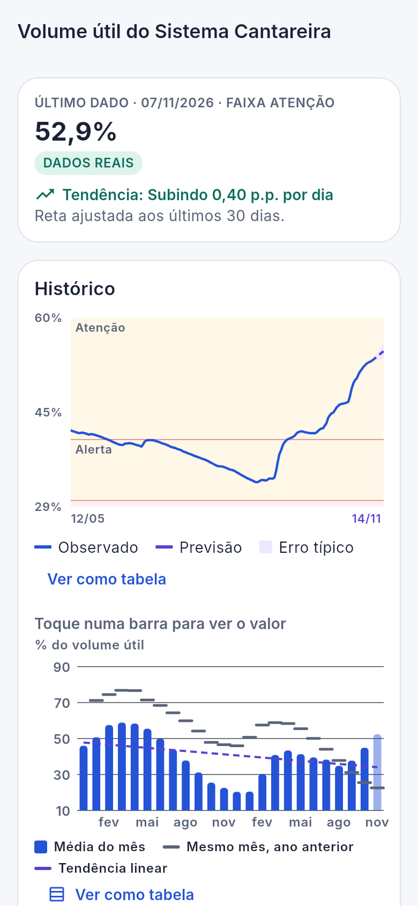<br><sub><b>10.</b> Detalhe do indicador Volume</sub></td>
    <td align="center">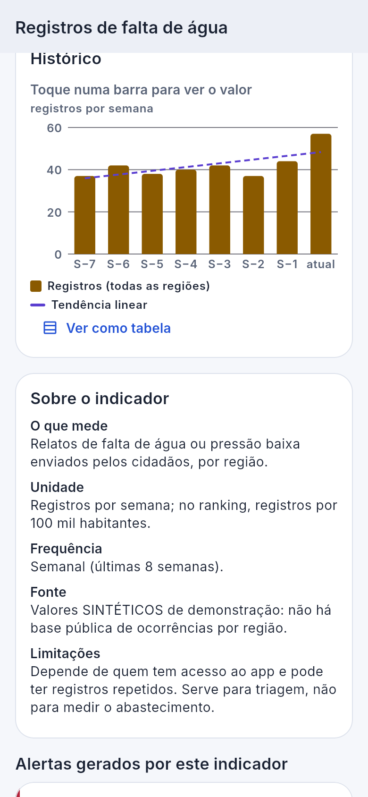<br><sub><b>11.</b> Indicador Registros e seus alertas</sub></td>
    <td align="center">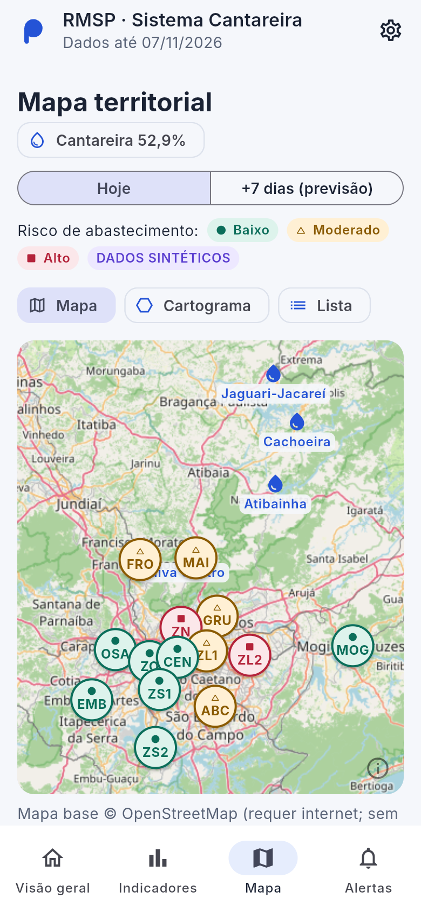<br><sub><b>12.</b> Mapa OpenStreetMap por região</sub></td>
  </tr>
  <tr>
    <td align="center">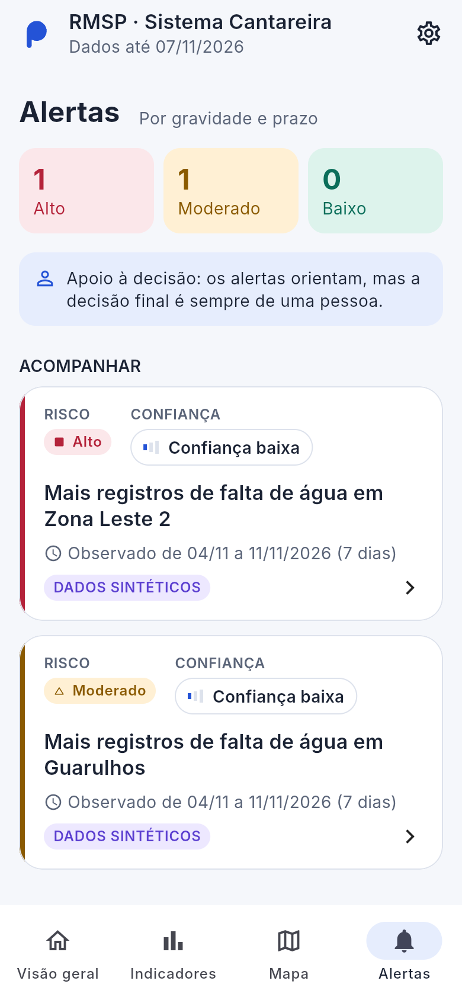<br><sub><b>13.</b> Alertas com janela temporal</sub></td>
    <td align="center">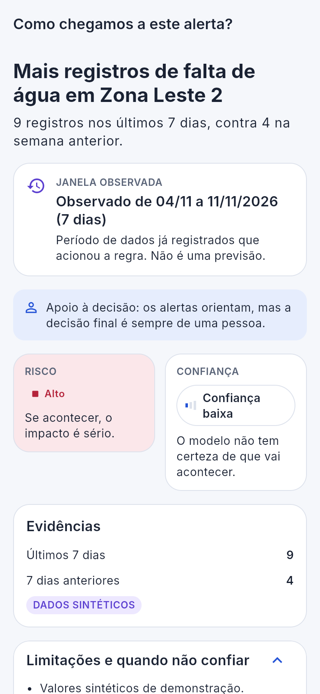<br><sub><b>14.</b> Justificativa: janela, risco, confiança</sub></td>
    <td align="center">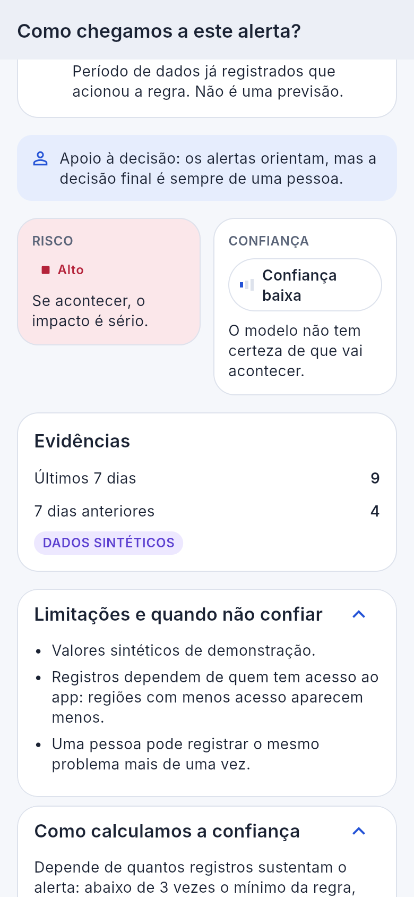<br><sub><b>15.</b> Evidências, limitações e cálculo da confiança</sub></td>
    <td align="center">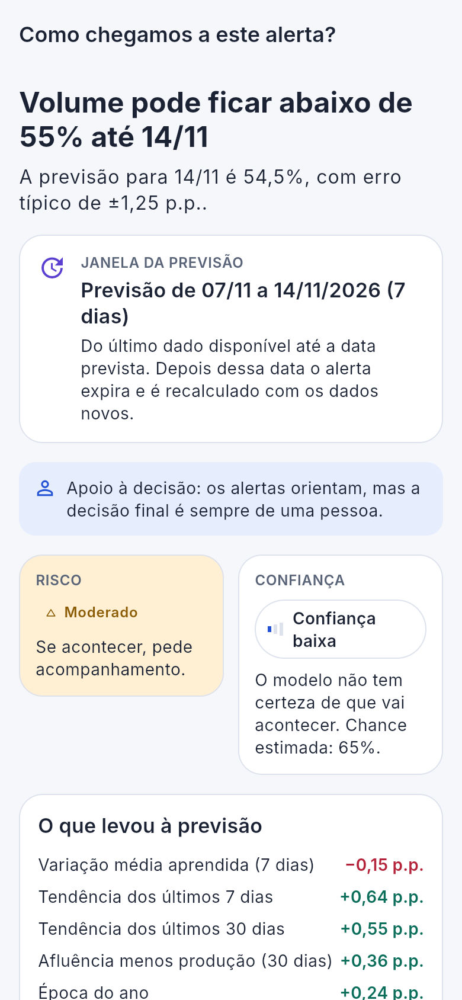<br><sub><b>16.</b> Alerta de previsão (limiar 55 %)</sub></td>
  </tr>
  <tr>
    <td align="center">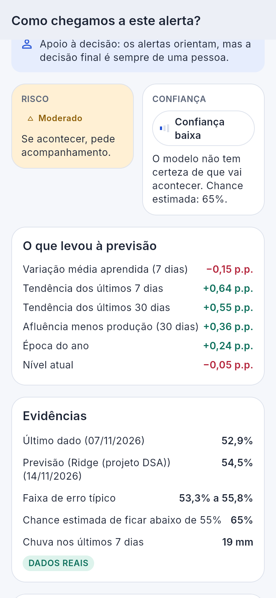<br><sub><b>17.</b> Fatores da previsão e evidências</sub></td>
    <td align="center"><br><sub><b>18.</b> Registro de ocorrência (4 etapas)</sub></td>
    <td align="center">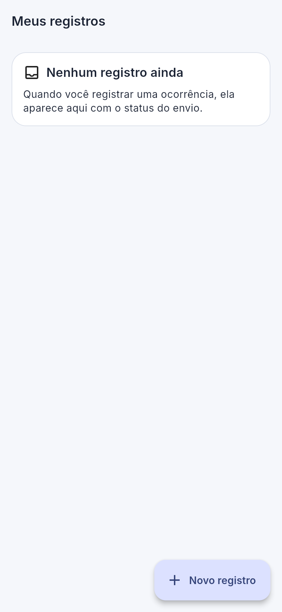<br><sub><b>19.</b> Meus registros (lista vazia)</sub></td>
    <td align="center">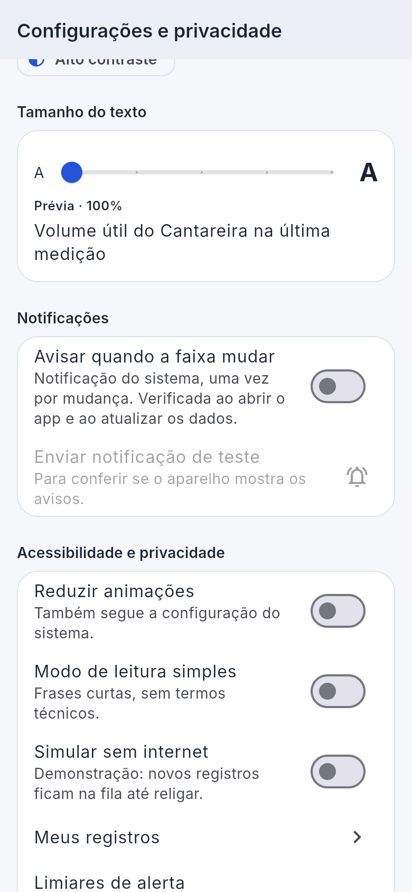<br><sub><b>20.</b> Configurações e privacidade</sub></td>
  </tr>
  <tr>
    <td align="center">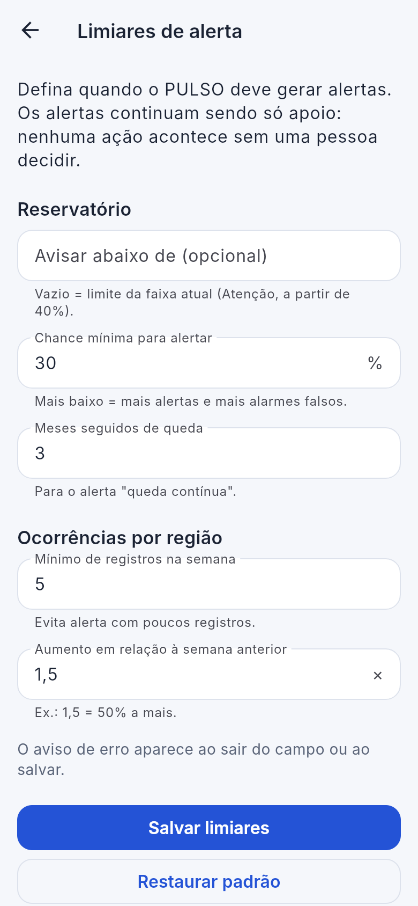<br><sub><b>21.</b> Formulário de limiares</sub></td>
    <td align="center">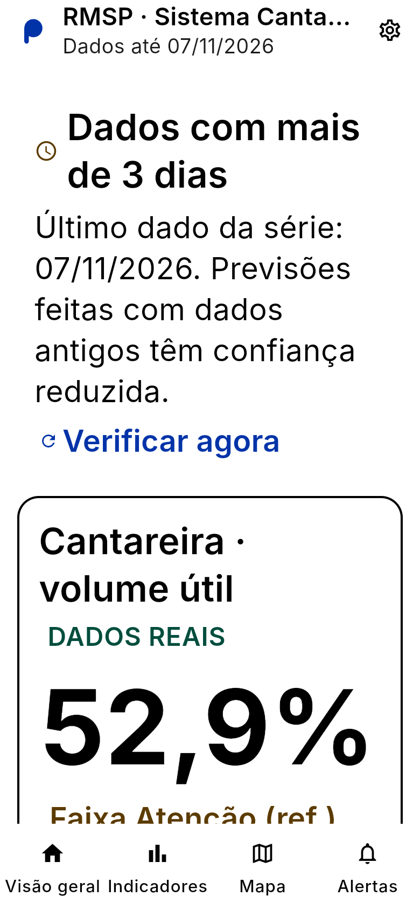<br><sub><b>22.</b> Alto contraste e texto 200 %</sub></td>
    <td align="center">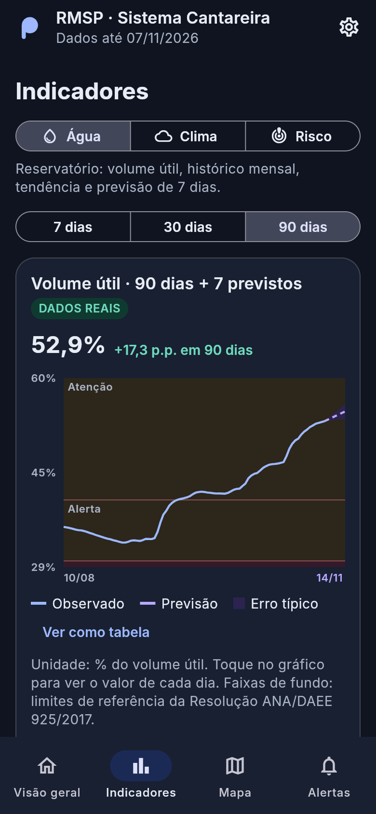<br><sub><b>23.</b> Tema escuro</sub></td>
    <td></td>
  </tr>
</table>

## 5. Funcionalidades

### 5.1 Checklist

- [x] 12 telas com rotas nomeadas e passagem de parâmetros (`/indicadores/:aba`, `/indicador/:indicador`, `/alertas/:id`, `/ocorrencias/:protocol/enviada`, `?regiao=`)
- [x] Fluxo completo visão geral → detalhe do indicador → alerta → justificativa
- [x] Três dashboards temáticos — **Água**, **Clima** e **Risco territorial** — com gráficos, histórico, tendência e unidades
- [x] Alertas gerados por regras e previsão, cada um com evidência, nível de confiança, janela temporal, limitações e a regra usada
- [x] Seção "Como calculamos a confiança" em cada alerta, com as situações em que ela cai
- [x] Aviso visível de que o alerta apoia, mas não substitui, a decisão humana (alertas, detalhe, indicadores)
- [x] Encaminhamento para análise humana registrado com data e hora; nenhuma ação automática
- [x] Estado global compartilhado entre telas e estados de carregamento, erro, lista vazia, cópia salva e dados desatualizados
- [x] API externa real (Open-Meteo) e envio de ocorrências por API simulada
- [x] Persistência local de ocorrências, limiares, preferências, consentimento, decisões e caches
- [x] Uso offline: pacote embutido, cache e fila de envio
- [x] Formulários com validação e mensagens de erro: registro de ocorrência e limiares de alerta
- [x] Indicador de benefício social medido por backtest
- [x] Consentimento explícito e remoção automática de dados pessoais digitados
- [x] Temas claro, escuro e alto contraste; texto até 200 %; leitores de tela; "ver como tabela"
- [x] Mapa OpenStreetMap, notificação local de mudança de faixa e testes automatizados (diferenciais)

### 5.2 Telas e rotas

| Tela | Rota | Função |
|---|---|---|
| Consentimento | `/consentimento` | O que é guardado, o que nunca é pedido e aceite explícito |
| Visão geral | `/` | Volume, faixa, "o que isso significa", gráfico com previsão, alerta em destaque, benefício social |
| Dashboards | `/indicadores/:aba` (`agua`, `clima`, `risco`) | Três painéis temáticos |
| Detalhe do indicador | `/indicador/:indicador` (`volume`, `chuva`, `registros`) | Definição, unidade, fonte, histórico longo, tendência e alertas gerados por ele |
| Mapa territorial | `/mapa` | OpenStreetMap com represas e regiões, cartograma offline e lista, com Hoje / +7 dias |
| Alertas | `/alertas` | Lista por gravidade e prazo, com janela temporal |
| Detalhe do alerta | `/alertas/:id` | Janela, risco × confiança, evidências, limitações, cálculo da confiança, regra e encaminhamento |
| Registro de ocorrência | `/ocorrencias/nova?regiao=` | Quatro etapas com validação |
| Confirmação | `/ocorrencias/:protocol/enviada` | Protocolo e status real do envio |
| Meus registros | `/ocorrencias` | Histórico com fila offline |
| Configurações | `/configuracoes` | Tema, texto, notificações, acessibilidade e privacidade |
| Limiares de alerta | `/configuracoes/limiares` | Formulário do gestor |

### 5.3 Dashboards

| Dashboard | Gráficos e indicadores | Unidades |
|---|---|---|
| **Água** (reservatório) | Volume em 7/30/90 dias sobre as faixas de referência com previsão e faixa de erro; tendência linear; mínimo, máximo, faixa atual e previsão; histórico mensal de 12 meses contra o mesmo mês do ano anterior; erro do modelo; contribuição de cada fator | % do volume útil, p.p. |
| **Clima** (bacia) | Chuva acumulada no período contra o ano anterior; chuva por semana (12 semanas) com tendência; chuva por mês contra o ano anterior; previsão de 5 dias da Open-Meteo | mm, °C, % de chance |
| **Risco territorial** | Regiões por nível de risco hoje e em +7 dias; registros por semana (8 semanas) com tendência; ranking por 100 mil habitantes com seta de variação; benefício social | registros/semana, registros/100 mil hab. |

Todos os gráficos têm eixo com unidade, toque para ver o valor e alternativa "Ver como tabela" para leitores de tela.

## 6. Dados e alertas

### 6.1 Fontes: o que é real, o que é simulado

| Dado | Origem | Tipo | Etiqueta no app |
|---|---|---|---|
| Volume útil e chuva diária do Cantareira (01/01/2024–07/11/2026) | Sabesp, Portal dos Mananciais, extraído e validado no projeto de Data Science da GS (SHA-256 conferido em `tool/build_pulso_data.py`) | **Real**, embutido no app | `DADOS REAIS` |
| Previsão de 7 dias e métricas do modelo | Ridge (α = 100) do projeto de Data Science, treinado sobre a série real | **Real** (modelo próprio) | `DADOS REAIS` |
| Previsão do tempo de 5 dias | [Open-Meteo](https://open-meteo.com/), API pública sem chave | **API externa real**, consultada ao abrir o dashboard Clima | Cópia salva quando offline |
| Mapa base | [OpenStreetMap](https://www.openstreetmap.org/copyright) via flutter_map | **Serviço externo real** | Atribuição na tela |
| Envio de ocorrências | `SimulatedReportApi` (latência e falha sem conexão) | **Simulado** — não há servidor de triagem | Status do envio |
| Registros por região e histórico semanal | Gerados por `tool/generate_placeholder_data.py` e `tool/region_history.py` | **Sintético** — não há dado público por região | `DADOS SINTÉTICOS` |

### 6.2 Comportamento sem conexão e com falha da API

| Fonte | Ordem de tentativa | Quando tudo falha |
|---|---|---|
| Pacote de dados do território | Remoto (`PULSO_DATA_URL`, opcional) → cache local → pacote embutido | Nunca fica sem dados: o embutido sempre existe. O app mostra a origem ("cópia salva", "dados embutidos") e a idade do dado |
| Open-Meteo | API → cópia salva com data e hora | Mensagem "Sem conexão e sem previsão salva" com botão Tentar de novo; o resto do dashboard continua |
| Mapa OpenStreetMap | Tiles da internet | Cartograma hexagonal e lista funcionam offline |
| Envio de ocorrência | Salva no aparelho primeiro, depois tenta enviar | Fica "Aguardando internet" e é reenviada pelo botão "Enviar agora" |

Ocorrências, limiares, preferências, consentimento e decisões ficam em `shared_preferences` e sobrevivem ao fechamento do app — comprovado em `test/persistence_test.dart`, que reabre o app três vezes sobre o mesmo armazenamento.

### 6.3 Como os alertas são gerados

| Regra | Indicador | Dispara quando | Gravidade | Janela |
|---|---|---|---|---|
| Previsão abaixo do limiar | Volume | Chance ≥ 30 % de o volume em 7 dias ficar abaixo do limite da faixa atual (ou do limiar do gestor) | Alta se levar às faixas Restrição ou Especial; moderada nas demais | Previsão: do último dado até a data prevista |
| Queda contínua | Volume | N janelas de 30 dias seguidas com média menor que a anterior | Moderada | Observada: as N + 1 janelas comparadas |
| Alta de ocorrências | Registros | ≥ 5 registros na semana e ≥ 1,5 × a semana anterior | Alta a partir de 8 registros | Observada: últimos 7 dias |

### 6.4 Como a confiança é calculada

- **Previsão abaixo do limiar.** Supondo erro de previsão aproximadamente normal, com desvio igual ao RMSE do teste (±1,25 p.p.), a chance é `Φ((limiar − previsão) / desvio)`. Abaixo de 60 %: confiança baixa; de 60 % a 85 %: média; acima de 85 %: alta.
- **Queda contínua.** Alta, porque descreve o que já aconteceu (médias observadas), sem previsão.
- **Alta de ocorrências.** Baixa com menos de 3 × o mínimo de registros da regra; média acima disso; nunca alta, porque registros dependem de quem usa o app.

### 6.5 Quando a confiança cai ou a previsão não é confiável

| Situação | Efeito |
|---|---|
| Último dado com mais de 3 dias | Confiança reduzida em um nível e aviso na Visão geral |
| Último dado com mais de 30 dias | Alerta vira "apenas informativo" e não deve orientar decisão |
| Chuva muito acima ou abaixo do padrão recente | O modelo aprende com o histórico e erra mais; listado nas limitações |
| Mudança de operação (transferências, obras, rodízio) | Não entra no modelo; listado nas limitações |
| Pacote sem previsão do modelo treinado | O app usa tendência linear de 14 dias, mais frágil, e diz isso na tela |
| Dados sintéticos | A confiança descreve a regra, não o mundo real; etiqueta em todo lugar |

### 6.6 Métricas, limitações e vieses

| Métrica | Valor |
|---|---|
| MAE da previsão de 7 dias (Ridge) | 0,767 p.p. |
| MAE de repetir o valor de hoje | 1,097 p.p. |
| RMSE usado como erro típico | 1,248 p.p. |
| Backtest de antecedência | 6 de 6 pioras avisadas, 5,8 dias em média, 51 dias com alerta, 16 sem piora em 7 dias (acerto de 69 %) |

**Limitações:** um único sistema produtor; horizonte de 7 dias; o último dado embutido é de 07/11/2026; posições das regiões no mapa são aproximadas; o envio de ocorrências é simulado; a notificação de mudança de faixa é verificada ao abrir o app, sem push em segundo plano.

**Vieses possíveis:** registros de cidadãos super-representam regiões com mais acesso a smartphone e internet (mitigado em parte pela normalização por 100 mil habitantes, mas não eliminado); a chuva é média da bacia e não representa cada bairro; o modelo foi treinado em 2024–2026, período de recuperação depois de uma seca, e pode errar mais em regimes diferentes.

## 7. Privacidade e inclusão

| Privacidade | Acessibilidade e inclusão |
|---|---|
| Consentimento explícito antes de qualquer uso, com o que é guardado e o que nunca é pedido | Temas claro, escuro e alto contraste |
| Sem nome, telefone, CPF, e-mail ou endereço — apenas a região | Texto até 200 % sem quebrar a tela, testado em 360 px |
| Telefone, e-mail, CPF, CEP e endereço digitados são detectados, o usuário é avisado e o dado é removido antes de salvar | Gravidade sempre com ícone e texto, nunca só cor |
| Protocolo aleatório, sem identificador do aparelho | `Semantics` em números, gráficos e mapa; "Ver como tabela" em todos os gráficos |
| Tudo fica no aparelho; "Apagar meus dados locais" remove tudo | Alvos de toque ≥ 48 dp, reduzir animações e modo de leitura simples |

## 8. Tecnologias e decisões técnicas

### 8.1 Bibliotecas e serviços

| Escolha | Justificativa |
|---|---|
| Flutter + Material 3 | Requisito da disciplina; `ThemeExtension` para cores semânticas nos três temas |
| flutter_riverpod | Estado global separado do local; `AsyncValue` representa carregando, erro e dados sem código repetido |
| go_router com `StatefulShellRoute` | Rotas nomeadas com parâmetros e quatro abas que preservam o estado |
| dio | Timeout e erros tipados nas fontes remotas |
| shared_preferences | Persistência simples e multiplataforma para preferências, limiares, registros, decisões e caches |
| flutter_map + OpenStreetMap | Mapa nativo sem WebView e sem chave, com marcadores acessíveis |
| flutter_local_notifications | Notificação de mudança de faixa em Android, iOS, web e Linux |
| Open-Meteo | API de clima pública e sem chave: nada de segredo no repositório |
| Gráficos próprios com `CustomPainter` | Controle total de acessibilidade, faixas de referência e alternativa em tabela, sem dependência extra |
| Domínio em Dart puro | Faixas, previsão, confiança, alertas, backtest, agregados e validações testados sem Flutter |
| Inter embutida (OFL) | Fiel ao design system do Figma e disponível offline |

### 8.2 Arquitetura

```
lib/
├── app/            rotas (go_router), shell com 4 abas e providers globais
├── core/           tema (tokens, 3 modos), formatação pt-BR, detector de dados pessoais
├── shared/         componentes reutilizáveis (logo, badges, gráficos, estados, cards)
└── features/
    ├── reservoir/     domínio (faixas, previsão) e repositório com fallback
    ├── alerts/        motor de alertas, confiança, janela, backtest e telas
    ├── indicators/    três dashboards, detalhe do indicador e agregados (domain/)
    ├── map/           mapa OpenStreetMap, cartograma e risco por região
    ├── notifications/ notificação de mudança de faixa
    ├── reports/       registro de ocorrências e fila offline
    ├── weather/       Open-Meteo com cache
    ├── settings/      preferências, limiares e consentimento
    └── onboarding/    consentimento
tool/               geração do pacote de dados (Python)
test/               testes de unidade, widget, persistência e layout
```

```
Sabesp (via projeto DSA) ─► tool/build_pulso_data.py ─► assets/data/pulso_data.json
                                                              │
fonte remota (opcional) ─► TerritoryRepository: remoto → cache → embutido
                                                              │
                                   territoryProvider (estado global)
                                     │            │              │
                              alertsProvider  reservoirProvider  socialImpactProvider
                                     │
       Visão geral · Alertas · Detalhe do alerta · Detalhe do indicador · Mapa
```

**Estado global × local.** Global (Riverpod): dados do território, alertas (5 telas), registros (formulário, confirmação, Meus registros, Configurações), limiares (Limiares e todas as telas de alerta), preferências e decisões. Local (`setState`): período escolhido no dashboard, etapa do formulário, ponto tocado no gráfico. Ao salvar um limiar de 55 %, o novo alerta aparece na hora em Visão geral, Alertas, Mapa e Detalhe do indicador.

### 8.3 Qualidade

| Grupo | O que cobre |
|---|---|
| Domínio | Faixas, motor de alertas, janela temporal, confiança, previsão, agregados mensais e semanais, backtest e validações |
| Dados e persistência | Repositório com fallback, cache corrompido, Open-Meteo e reabertura do app com ocorrências, limiares e preferências |
| Privacidade | Detecção e mascaramento de dados pessoais |
| Telas | Consentimento, visão geral, mudança de faixa e notificação |
| Acessibilidade | Cada tela, incluindo os três detalhes de indicador, em 360 px com texto 200 % e alto contraste, e em 390 px no tema escuro; alvos de toque rotulados com ≥ 48 dp |

Design no Figma *PULSO — Radar Territorial* (logo "B2 · P em movimento" na página 01, handoff na página 05). Mais detalhes em [`docs/ARCHITECTURE.md`](docs/ARCHITECTURE.md).

## 9. Como executar

### 9.1 Pré-requisitos

- Flutter 3.35 ou superior (testado em 3.47.9, canal stable) — `flutter doctor` sem erros para a plataforma escolhida.
- Para Android: Android Studio com um emulador (API 24 ou superior) ou um aparelho com depuração USB.
- Nenhuma chave de API ou variável de ambiente obrigatória.

### 9.2 Passo a passo

```bash
git clone https://github.com/JoaoVictorAAbreu-Dev/gs-2026-cpad
cd gs-2026-cpad
flutter pub get
flutter devices                 # lista emuladores e aparelhos
flutter run -d emulator-5554    # Android (use o id mostrado acima)
flutter run -d chrome           # ou no navegador
```

### 9.3 Verificar

```bash
flutter analyze   # sem avisos
flutter test      # 84 testes
```

### 9.4 Configuração opcional

| Objetivo | Como |
|---|---|
| Buscar o pacote de dados de uma URL | `flutter run --dart-define=PULSO_DATA_URL=https://<servidor>/pulso_data.json` |
| Regenerar o pacote de dados | `python3 tool/generate_placeholder_data.py` (regiões sintéticas) e `python3 tool/build_pulso_data.py` (série real + Ridge; requer pandas e scikit-learn) |
| Gerar APK de release | `flutter build apk --release` (saída em `build/app/outputs/flutter-apk/`) |
| Demonstrar o modo offline | Configurações › Simular sem internet |
| Ver um alerta de previsão | Configurações › Limiares › "Avisar abaixo de" = 55 |
| Recomeçar do consentimento | Configurações › Apagar meus dados locais |

## 10. Vídeo

Link: _a publicar_. Roteiro de até 3 minutos, com cenas, tempos e o critério da rubrica de cada cena, em [`docs/VIDEO.md`](docs/VIDEO.md); falas para a narração, com tempos, em [`docs/NARRACAO.md`](docs/NARRACAO.md).

## 11. Licença

Projeto acadêmico — FIAP, Global Solution 2026.2. Uso educacional.

| Item | Fonte e licença |
|---|---|
| Dados do Cantareira | Sabesp, Portal dos Mananciais, com atribuição |
| Previsão do tempo | Open-Meteo (CC BY 4.0) |
| Mapa base | © OpenStreetMap contributors (ODbL), exibido com flutter_map |
| Faixas de operação | Resolução Conjunta ANA/DAEE nº 925/2017 |
| Fonte tipográfica | Inter, SIL Open Font License 1.1 (`assets/fonts/inter/LICENSE-OFL.txt`) |
