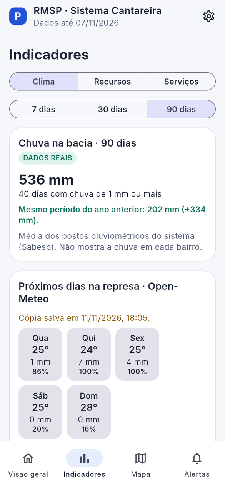
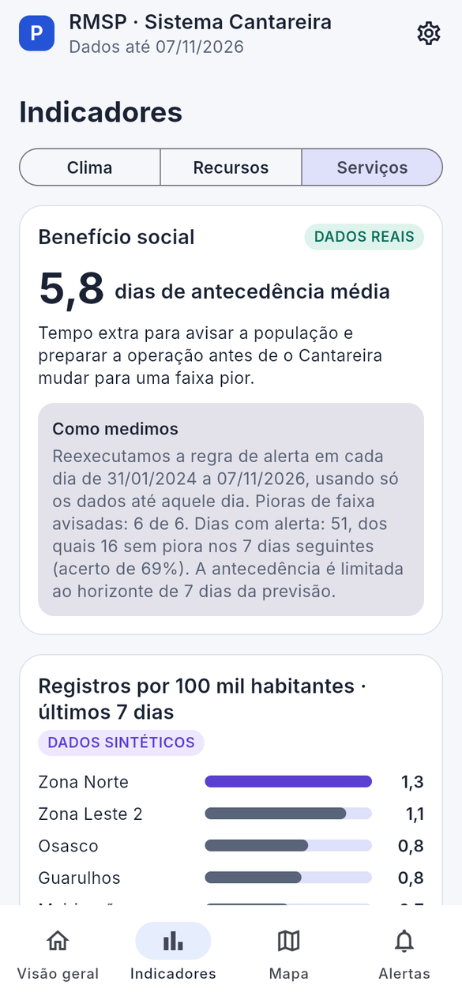
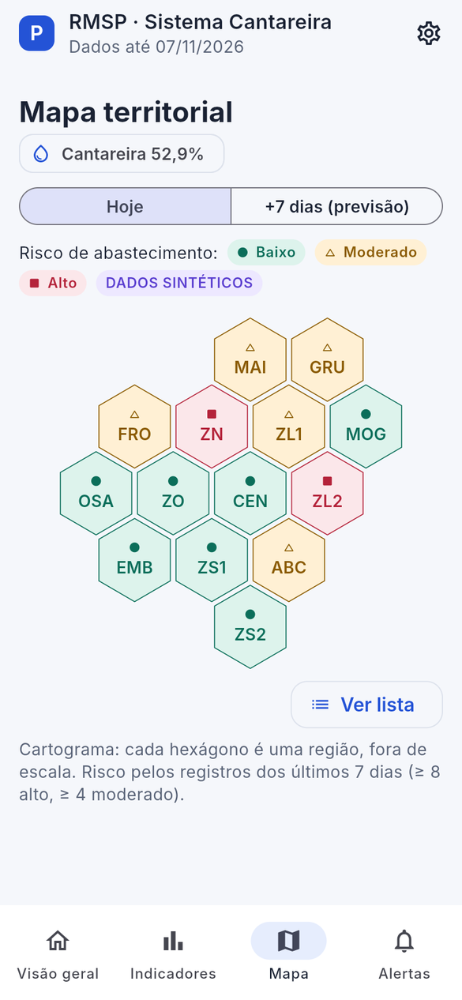
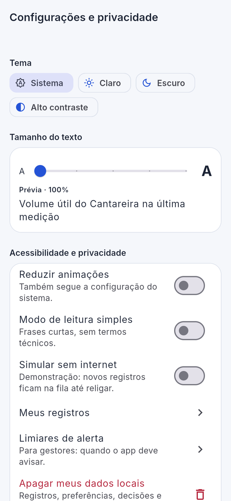

**Integrantes:** João Victor Alves de Abreu (RM 564946) e Rodrigo Kenshin Viana Matayoshi (RM 564026).

<div align="center">

# PULSO — Radar Territorial

**App Flutter que antecipa a mudança de faixa do Sistema Cantareira e mostra, para cada alerta, a evidência, a confiança e os limites — a decisão final é sempre humana.**

Global Solution 2026.2 · Cross-Platform Application Development · FIAP — *Territory Predictive Insights*

    

   

   

</div>

## 👥 Integrantes

| Nome | RM |
|---|---|
| **João Victor Alves de Abreu** | 564946 |
| **Rodrigo Kenshin Viana Matayoshi** | 564026 |

## 📑 Sumário

1. [Problema e público](#-problema-e-público)
2. [Solução em números](#-solução-em-números)
3. [Demonstração visual](#-demonstração-visual)
4. [Funcionalidades](#-funcionalidades)
5. [Dados e fontes](#-dados-e-fontes)
6. [Alertas e transparência](#-alertas-e-transparência)
7. [Benefício social](#-benefício-social)
8. [Privacidade e acessibilidade](#-privacidade-e-acessibilidade)
9. [Arquitetura e decisões técnicas](#-arquitetura-e-decisões-técnicas)
10. [Testes](#-testes)
11. [Como executar](#-como-executar)
12. [Vídeo de demonstração](#-vídeo-de-demonstração)
13. [Atendimento à rubrica](#-atendimento-à-rubrica)

---

## 🎯 Problema e público

Metade da Região Metropolitana de São Paulo é abastecida pelo **Sistema Cantareira**, que opera em faixas definidas pela Resolução Conjunta ANA/DAEE nº 925/2017. Quando o volume cai de faixa, a retirada de água é reduzida — e moradores e gestores costumam saber disso tarde.

| Público | O que o PULSO entrega |
|---|---|
| **Gestor público** | Indicadores, previsão de 7 dias, alertas com evidência e confiança, limiares ajustáveis e encaminhamento para análise humana |
| **Cidadão** | Situação em linguagem simples, mapa da sua região e registro de ocorrências sem se identificar |

## 📊 Solução em números

| | |
|---|---|
| **52,9 %** | volume útil do Cantareira em 07/11/2026 (faixa Atenção, +29,4 p.p. em um ano) |
| **54,5 %** | previsão para 14/11/2026 (Ridge, erro típico ±1,25 p.p.) |
| **6 de 6** | pioras de faixa que a regra de alerta teria avisado em 2024–2026 |
| **5,8 dias** | antecedência média desses avisos |
| **63** | testes automatizados, incluindo todas as telas com texto em 200 % |

## 📱 Demonstração visual

Capturas em 390×844 com os dados reais embutidos (série até 07/11/2026). O aviso "Dados com mais de 3 dias" é proposital: quando o último dado envelhece, o app avisa e reduz a confiança das previsões.

<table>
  <tr>
    <td align="center"><br><sub>Consentimento</sub></td>
    <td align="center"><br><sub>Visão geral</sub></td>
    <td align="center"><br><sub>Alerta em destaque</sub></td>
    <td align="center"><br><sub>Recursos</sub></td>
  </tr>
  <tr>
    <td align="center"><br><sub>Fatores da previsão</sub></td>
    <td align="center"><br><sub>Clima (Open-Meteo)</sub></td>
    <td align="center"><br><sub>Serviços e benefício social</sub></td>
    <td align="center"><br><sub>Mapa territorial</sub></td>
  </tr>
  <tr>
    <td align="center"><br><sub>Alertas</sub></td>
    <td align="center"><br><sub>Detalhe do alerta</sub></td>
    <td align="center"><br><sub>Registro de ocorrência</sub></td>
    <td align="center"><br><sub>Meus registros</sub></td>
  </tr>
  <tr>
    <td align="center"><br><sub>Configurações</sub></td>
    <td align="center"><br><sub>Limiares de alerta</sub></td>
    <td align="center"><br><sub>Alto contraste + texto 200 %</sub></td>
    <td align="center"><br><sub>Tema escuro</sub></td>
  </tr>
</table>

## ✨ Funcionalidades

<details open>
<summary><b>Visão geral e dashboards</b></summary>

- **Visão geral**: volume útil, faixa de operação, variação em 1 ano, "o que isso significa", gráfico de 30 dias com previsão e faixa de erro, aviso de mudança de faixa desde a última visita e "copiar resumo" com fonte.
- **Três dashboards** em `/indicadores/:aba`:
  - *Recursos* — série de 7/30/90 dias sobre as faixas de referência, erro do modelo × baseline e "o que levou à previsão".
  - *Clima* — chuva na bacia × mesmo período do ano anterior e previsão de 5 dias da Open-Meteo.
  - *Serviços* — benefício social e registros por 100 mil habitantes.
- **Mapa territorial**: cartograma hexagonal com Hoje / +7 dias, painel da região, "Registrar aqui" e versão em lista.

</details>

<details open>
<summary><b>Alertas e decisão humana</b></summary>

- Alertas por regras transparentes, separando **risco** (impacto) e **confiança** (probabilidade).
- Detalhe em `/alertas/:id` com evidências, limitações, regra usada e métricas do modelo.
- **Encaminhar para análise humana** registra a decisão; nenhuma ação é automática.
- **Limiares do gestor** (formulário validado) recalculam os alertas em todas as telas.

</details>

<details open>
<summary><b>Registro de ocorrências e uso offline</b></summary>

- Registro em 4 etapas (tipo, região, descrição, revisão) com validação e protocolo aleatório.
- Telefone, CPF, e-mail, CEP e endereço são detectados e removidos antes de salvar.
- **Meus registros** com status real e fila offline (envio por API simulada).
- Dados em três camadas: fonte remota → cache local → pacote embutido.
- Estados de carregamento, erro, vazio, cópia salva e dados desatualizados.

</details>

## 🗂️ Dados e fontes

| Dado | Origem | Etiqueta no app |
|---|---|---|
| Volume útil, chuva e vazões do Cantareira (01/01/2024–07/11/2026) | Sabesp, Portal dos Mananciais — extraído e validado no projeto de Data Science da GS (SHA-256 conferido em `tool/build_pulso_data.py`) | `DADOS REAIS` |
| Previsão de 7 dias e métricas | Ridge (α = 100) do projeto DSA; erro da validação walk-forward jan/2025–set/2026 (638 previsões) | `DADOS REAIS` |
| Previsão do tempo (5 dias) | [Open-Meteo](https://open-meteo.com/), API pública sem chave, com cache local | — |
| Ocorrências por região | Sintéticas — não há dado público por região | `DADOS SINTÉTICOS` |

Gerar o pacote `assets/data/pulso_data.json` (esquema v1):

```bash
python3 tool/generate_placeholder_data.py   # regiões sintéticas
python3 tool/build_pulso_data.py            # série real + previsão Ridge
```

## 🚨 Alertas e transparência

| Regra | Dispara quando | Gravidade |
|---|---|---|
| **Previsão abaixo do limiar** | Chance ≥ 30 % de o volume em 7 dias ficar abaixo do limite da faixa (ou do limiar do gestor). Chance = Φ((limiar − previsão) / erro típico) | Alta se levar às faixas Restrição ou Especial |
| **Queda contínua** | N janelas de 30 dias seguidas com média menor que a anterior | Moderada |
| **Alta de ocorrências** | ≥ 5 registros na semana e ≥ 1,5× a semana anterior | Alta a partir de 8 (mesma regra do mapa) |

- **Confiança**: < 60 % baixa · 60–85 % média · > 85 % alta.
- **Quando não confiar**: dados com mais de 3 dias reduzem a confiança em um nível; com mais de 30 dias o alerta vira apenas informativo. A chance supõe erro aproximadamente normal e não considera chuvas extremas, mudanças de operação nem outros sistemas produtores.
- **Decisão humana**: o app recomenda, não decide.

## 💚 Benefício social

`LeadTimeBacktest` reexecuta a regra de previsão em cada dia de 31/01/2024 a 07/11/2026, usando **apenas os dados disponíveis até aquele dia**, e mede quantos dias antes de cada piora de faixa o alerta começou.

| Pioras de faixa | Avisadas | Antecedência média | Dias com alerta | Sem piora em 7 dias |
|:---:|:---:|:---:|:---:|:---:|
| 6 | **6** | **5,8 dias** | 51 | 16 (acerto de 69 %) |

Resultado conferido por uma reimplementação independente em Python. A antecedência é limitada ao horizonte de 7 dias da previsão.

## 🔒 Privacidade e acessibilidade

| Privacidade | Acessibilidade |
|---|---|
| Consentimento antes de qualquer uso | Temas claro, escuro e alto contraste |
| Sem nome, telefone, CPF, e-mail ou endereço — só a região | Texto até 200 % sem quebrar a tela (testado em 360 px) |
| Dados pessoais digitados são detectados e removidos | Gravidade sempre com ícone + texto, nunca só cor |
| Protocolo aleatório, sem identificador do aparelho | `Semantics` em números, gráficos e mapa; "ver como tabela" |
| "Apagar meus dados locais" remove tudo do aparelho | Alvos de toque ≥ 48 dp; reduzir animações; leitura simples |

## 🏗️ Arquitetura e decisões técnicas

```
lib/
├── app/          rotas (go_router), shell com 4 abas, providers globais
├── core/         tema (tokens, 3 modos), formatação pt-BR, detector de dados pessoais
├── shared/       componentes reutilizáveis (badges, gráfico, estados, cards)
└── features/
    ├── reservoir/   domínio (faixas, previsão) + repositório com fallback
    ├── alerts/      motor de alertas, confiança, backtest + telas
    ├── indicators/  3 dashboards
    ├── map/         cartograma e risco por região
    ├── reports/     registro de ocorrências, fila offline
    ├── weather/     Open-Meteo com cache
    ├── settings/    preferências, limiares, consentimento
    └── onboarding/  consentimento
```

| Escolha | Por quê |
|---|---|
| **Flutter + Material 3** | Requisito da disciplina; `ThemeExtension` para cores semânticas nos 3 temas |
| **flutter_riverpod** | Estado global (dados, alertas, registros, limiares) separado do local (formulários, período); `AsyncValue` dá carregando/erro/dados |
| **go_router** (`StatefulShellRoute`) | Rotas nomeadas com parâmetros (`/indicadores/:aba`, `/alertas/:id`, `/ocorrencias/:protocol/enviada`) e abas que preservam o estado |
| **dio** | Timeout e erros tipados nas fontes remotas |
| **shared_preferences** | Preferências, consentimento, limiares, decisões, registros e caches |
| **Domínio em Dart puro** | Faixas, previsão, confiança, alertas, backtest e validações testados sem Flutter |
| **Fonte Inter embutida** | Fiel ao design system e funciona offline |

Mais detalhes em [`docs/ARCHITECTURE.md`](docs/ARCHITECTURE.md). Design no Figma: *PULSO — Radar Territorial* (página "05 · Handoff Flutter").

## 🧪 Testes

```bash
flutter analyze   # sem avisos
flutter test      # 63 testes
```

| Grupo | Cobre |
|---|---|
| Domínio | Faixas, motor de alertas, confiança, previsão, backtest (com o resultado da série real), validações |
| Dados | Repositório com fallback, cache corrompido, leitura da Open-Meteo |
| Privacidade | Detector e mascaramento de dados pessoais |
| Telas | Consentimento, visão geral, aviso de mudança de faixa |
| Acessibilidade | **Cada tela em 360 px com texto 200 % e alto contraste** (qualquer estouro reprova) e alvos de toque rotulados e ≥ 48 dp |

## ▶️ Como executar

**Pré-requisito:** Flutter 3.35 ou superior (testado em 3.47.9). Nenhuma chave de API é necessária.

```bash
git clone https://github.com/JoaoVictorAAbreu-Dev/gs-2026-cpad
cd gs-2026-cpad
flutter pub get
flutter run          # Android, iOS, web ou Linux, com os dados embutidos
```

Opcional, para buscar o pacote de dados de uma URL:

```bash
flutter run --dart-define=PULSO_DATA_URL=https://<usuario>.github.io/pulso-data/pulso_data.json
```

Para demonstrar o modo offline: Configurações › **Simular sem internet**.

## 🎬 Vídeo de demonstração

> _Link pendente._ Roteiro com cenas e tempos em [`docs/VIDEO.md`](docs/VIDEO.md).

## ✅ Atendimento à rubrica

| Requisito | Onde está |
|---|---|
| Ao menos 5 telas, rotas nomeadas e passagem de parâmetros | 13 telas; `/indicadores/:aba`, `/alertas/:id`, `/ocorrencias/:protocol/enviada`, `?regiao=` |
| 3 dashboards com gráficos, histórico e tendência | Recursos, Clima e Serviços |
| Alertas com evidência, confiança, limitações e decisão humana | Alertas → detalhe → encaminhar |
| Estado local/global compartilhado entre telas | `alertsProvider` (4 telas), `reportsProvider` (3 telas) |
| API real ou simulada, persistência local e uso offline | Open-Meteo, API de envio simulada, cache e fila offline |
| Formulário com validação | Registro de ocorrência (4 etapas) e Limiares |
| Tema e componentes reutilizáveis, responsividade | Tokens do Figma, `lib/shared/widgets`, testes em 360 e 390 px |
| Contraste, fonte ampliada e leitor de tela | Alto contraste, texto 200 %, `Semantics`, ver como tabela |
| Anonimização, consentimento e benefício social | Detector de dados pessoais, consentimento, backtest de antecedência |

Planejamento, requisitos e checklist de entrega em [`docs/`](docs/REQUIREMENTS.md).

---

<div align="center">
<sub>Projeto acadêmico — FIAP, Global Solution 2026.2 · Dados do Cantareira: Sabesp, com atribuição · Previsão do tempo: Open-Meteo · Fonte Inter: SIL Open Font License 1.1</sub>
</div>
